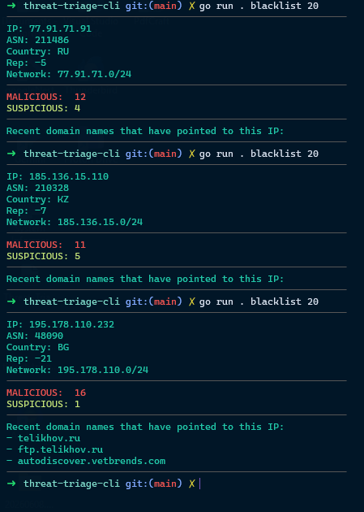

# SSH Log Monitoring & Threat Triage

A Go-based security operations portfolio project that turns SSH authentication failures into an analyst-reviewable IP list, then enriches selected indicators with VirusTotal data.

The project is split into two small tools:

1. **`ssh-monitor`** reads JSON-formatted `journald` records, extracts IPv4 addresses from failed SSH password attempts, removes duplicates, and writes a JSON blacklist.
2. **`threat-triage`** lets an analyst select an IP from that list or query an IP or file hash directly, then displays available VirusTotal context.

This project demonstrates a simple indicator-triage workflow—not an automated blocking or incident-response system.

## Workflow

```text
Linux systemd journal
        |
        | journalctl -o json -u ssh.service
        v
ssh-monitor
  - parses journal JSON
  - matches failed-password messages
  - validates and deduplicates IPv4 addresses
        |
        v
assets/blacklist.json
        |
        | analyst selects an IP
        v
threat-triage
  - queries VirusTotal IP data and recent resolutions
  - presents context for analyst review
```

## Repository layout

```text
.
├── ssh-monitor/       # Journal input parser and blacklist writer
├── threat-triage/     # Interactive Go CLI and VirusTotal clients
├── threat-triage-cli.png
└── README.md
```

## Requirements

- Go versions compatible with each module's `go.mod` (`ssh-monitor` and `threat-triage` are separate Go modules).
- Linux with `systemd`/`journalctl` to collect SSH service logs. You can also pipe a saved JSON-lines journal export to the parser.
- A VirusTotal API key for IP and file lookups.

## Getting started

### 1. Collect failed SSH login IPs

Build the log parser from its module directory:

```bash
cd ssh-monitor
go build -o out .
```

On the Linux host whose journal you want to inspect, run:

```bash
journalctl -o json -u ssh.service | ./out
```

The parser reads one JSON journal entry per line. It looks for `MESSAGE` values matching failed-password messages, accepts IPv4 addresses, and writes each unique address once. Invalid JSON lines are reported to stderr and skipped.

To process a previously saved journal export instead:

```bash
./out < journal.jsonl
```

### 2. Configure VirusTotal

From `threat-triage`, create a `.env` file and set your key:

```bash
cd ../threat-triage
```

```dotenv
VT_API_KEY=your_virustotal_api_key
```

The CLI loads `.env` when present; alternatively, set `VT_API_KEY` in your shell environment. **Do not commit API keys or other credentials.** The repository's `.gitignore` excludes `.env`.

### 3. Run triage

Run commands from the `threat-triage` directory:

```bash
go run . --help
go run . blacklist 20
go run . ipreport 8.8.8.8
go run . filereport YOUR_FILE_HASH
```

- `blacklist [COUNT]` loads up to `COUNT` entries (10 by default), opens an interactive selector, and displays a report for the chosen IP.
- `ipreport <IP_ADDRESS>` directly looks up an IP.
- `filereport <HASH>` requests a VirusTotal file report.

IP reports include VirusTotal analysis counts, reputation and network context, and recent domain resolutions when available. Results depend on the API response and account limits; treat them as leads for investigation, not a verdict.

## Example

An example IP-enrichment session from the CLI:



## Integration note

The current parser has a hard-coded output path of `/assets/blacklist.json`, while `threat-triage` reads `assets/blacklist.json` relative to its working directory. These paths do **not** automatically refer to the same file. To connect the tools, change `blacklistPath` in `ssh-monitor/main.go` to a suitable location or copy the generated file into `threat-triage/assets/blacklist.json`. The destination must exist and be writable.

The triage command must then be run with `threat-triage` as the current directory so it can find `assets/blacklist.json`.

## Scope and responsible use

- The parser currently targets IPv4 failed-password messages; it does not block addresses or take response actions.
- VirusTotal data is third-party enrichment and should be evaluated alongside other telemetry and organizational procedures.
- Use only on systems and logs you are authorized to access. Avoid uploading sensitive files or sharing credentials.
- This is a learning/portfolio project and is not intended as a production SIEM, detection engine, or automated response tool.

## Skills demonstrated

- Parsing structured Linux journal data and extracting indicators from authentication events.
- Input validation, error reporting, and in-memory deduplication in Go.
- Building a command-line investigation workflow with interactive indicator selection.
- Enriching indicators with a threat-intelligence API and presenting results for analyst review.
- Handling API credentials through environment variables rather than source code.

## Possible next steps

- Make the blacklist output path configurable and align it with the triage tool's input path.
- Add unit tests for journal parsing, malformed records, duplicate addresses, and IPv4 edge cases.
- Add safe sample journal records and mock API responses so the workflow can be demonstrated without live credentials or external requests.
- Add timestamps, source event counts, and other useful context to the blacklist format.
- Add explicit API-key validation, clearer API error handling, and documented rate-limit behavior for file lookups.

## Brief Video Demo

https://github.com/user-attachments/assets/9adfa21e-99e9-468a-9bd4-967d0ab5d979
